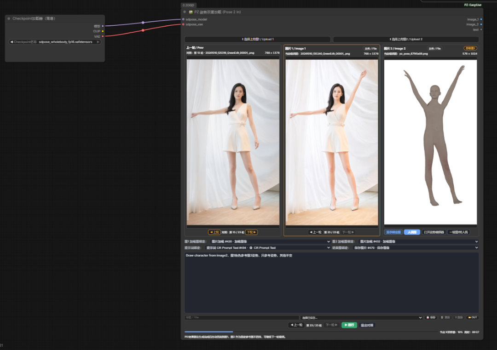
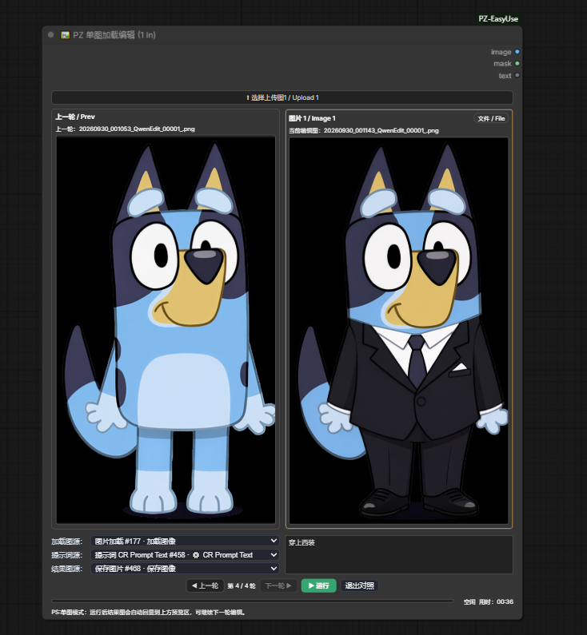
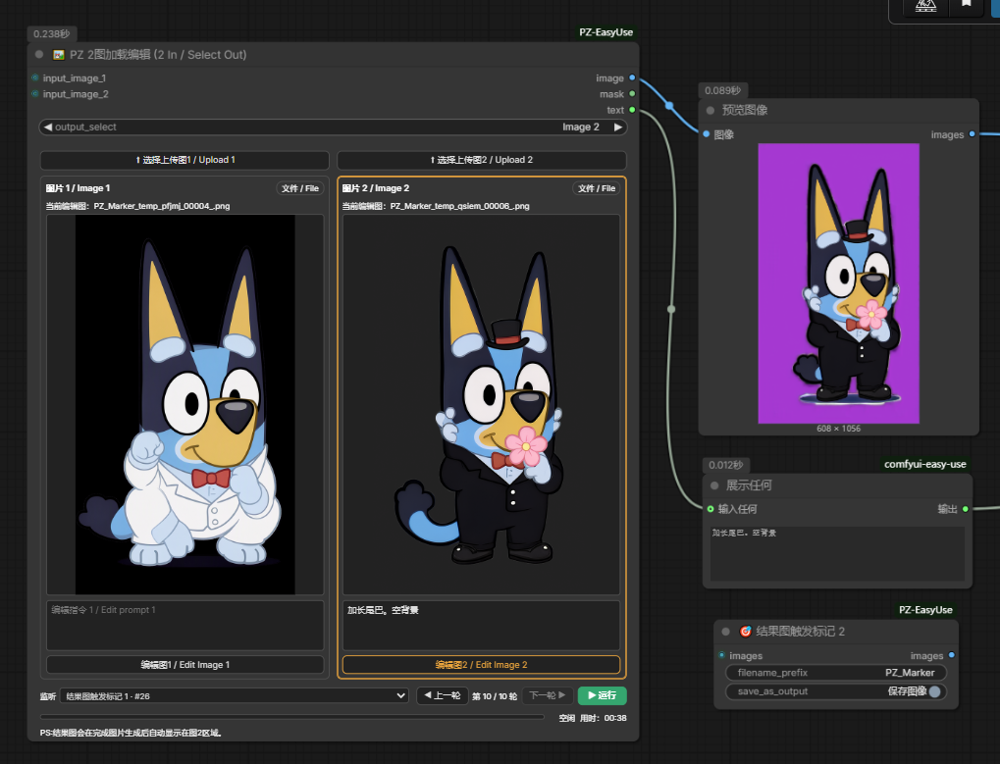
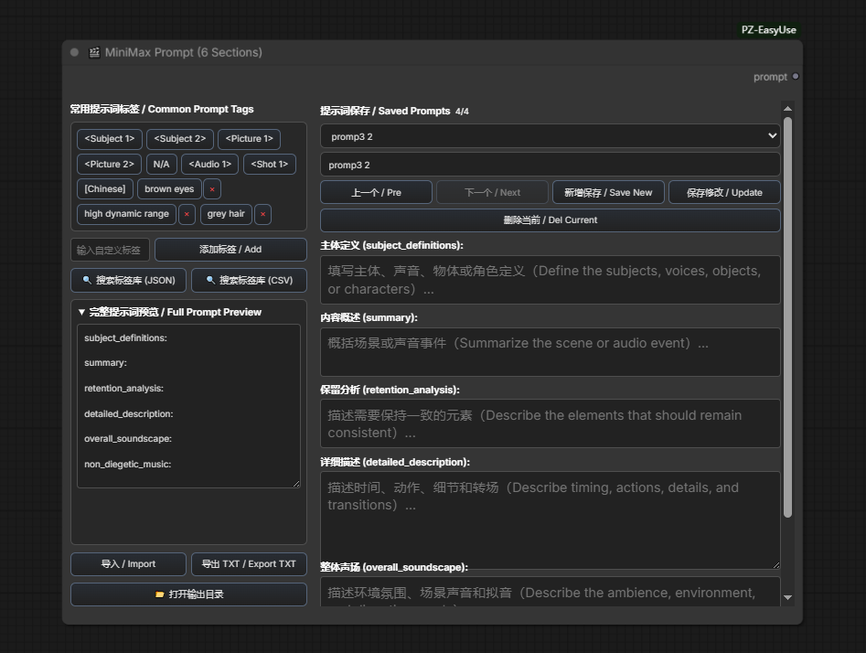
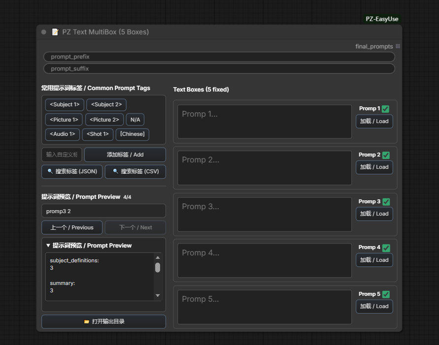
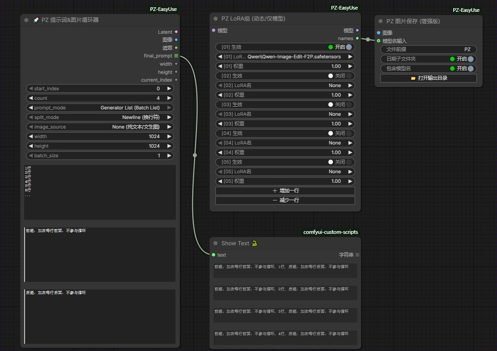

# ComfyUI PZ EasyUse Nodes

**PZ EasyUse** 是一套专为 **ComfyUI** 设计的高效工具节点包，旨在简化繁琐的工作流操作。

2026年10月11日：

新增 **PZ 姿势双图加载器 (PZ Pose Dual Image Loader)** —— 在 **PZ 2图加载编辑** 之上加了「内置姿势编辑器」：图1 仍是编辑目标，**图2 既能来自图片加载节点，也能由内置编辑器现摆现出**（VNCCS 3D 真人人偶图，或 OpenPose COCO-18 二维骨架图），还能用 SDPose 从图1 **一键提取姿势 → 自动摆好人偶 → 出图到图2**。主要功能：

- **图2 工具条（一行）**：`显示编辑器图 / 显示绑定图`（切换图2 预览显示编辑器结果，还是显示绑定节点里的图）、`[人偶图]`、`[打开姿势编辑器]`、`[一键图1转人偶]`。
- **一键图1转人偶**：把 `Checkpoint加载器` 的 `MODEL` / `VAE`（加载 SDPose 权重，如 `sdpose_wholebody_fp16.safetensors`）接到本节点的 `sdpose_model` / `sdpose_vae`，一键跑完「识别图1 骨架 → 后台自动摆姿 → 出 3D 人偶图到图2」；摆姿时按真人匹配身材与头部朝向；出图后编辑器**不关闭**，可继续微调再点 `应用到节点`。
- **姿势编辑器（VNCCS 3D 人偶）**：OpenPose 一键摆姿、拖关节摆姿（手脚髋 IK）、深度修正、手势 / 体型 / 比例微调、「我的姿势」「我的身材」预设。
- **骨架编辑器（OpenPose COCO-18）**：基于 fabric.js 的二维骨架编辑器，拖 18 个关键点摆姿、增删与补全、导入 / 导出 openpose JSON。
- **`⚙ 设置` 移进编辑器**（挨着 `锁定比例`）：SDPose 绘制参数、提取前缩放、`保留图1 背景`，改完写回本节点的隐藏控件 `sdpose_settings`，随工作流保存。
- 其余劫持 / 结果图回流 / 轮次 / 对照 / 用时显示与双图版一致。

2026年9月30日：

新增 **PZ 单图加载编辑 (PZ Single Image Loader)** —— 单图迭代编辑的“零连线”版本，主要功能：

- **自动劫持节点**：自动监听并“劫持”工作流中的「图片加载」节点、「提示词」文本节点、「保存图片」节点，**无需做任何连线**，把节点放进工作流区即可直接运行。
- **可手动更改劫持目标**：底部 `加载图源 / 提示词源 / 结果图源` 三个下拉可手动指定要劫持的节点，**避免自动劫持到错误的节点**（默认自动选中工作流中的第一个对应节点，可随时改）。
- **迭代闭环**：编辑结果图自动回显到预览区，并写回「加载图源」节点，使整张工作流的源图随编辑迭代更新；`上一轮 / 下一轮` 可回看历史轮次。
- **对照模式**：`对照 / 退出对照` 在原图与结果图之间切换比对。
- 底部显示运行进度与用时。

2026年9月29日：

新增并重构 **PZ 2图加载编辑 (PZ Dual Image Loader)**，并新增配套节点 **🎯 结果图触发标记 (PZ_Listen_Marker)**：

- 一次加载两张图并写编辑指令：图1 为编辑目标（结果图自动回流到图1），图2 为固定参考图，可继续下一轮编辑
- 输出 `image_1 / image_2 / text(STRING)`
- 顶部两个“选择上传图N”按钮；图片框标题下显示 `当前编辑图：xxx.png`；图2 右上角可 `忽略图2`
- 无需连线：自动劫持图片加载 / 提示词 / 保存图片节点，中部绑定下拉可手动更换目标
- 底部 `◀ 上一轮 / 第 N/M 轮 / 下一轮 ▶ / ▶ 运行 / 对照` 按钮；右下角显示本次任务 `用时：00:12`
- 图2 忽略可与绑定的图片加载节点双向同步；被忽略的加载节点仍保留在绑定下拉中并标注“已忽略”
- 结果图触发标记节点：图片透传，接在保存图片前后均可，开关可切换“保存图像 / 预览图像”

2026年9月6日：

更新增加了一个MINIMAX H3 手写提示词小工具PZ MiniMax Prompt (6 Sections)，可以自定义标签快速输入，根据推荐提示词格式分区书写，提示词可以保存在input文件夹下json文件，可导出导入。

2026年9月6日：

更新增加了一个MINIMAX H3 提示词批量循环任务的专用节点PZ text multibox，功能类同Iterate (JS Loop)：经典的“JS 帮你按多次按钮”。区别是这个可以直接快速加载PZ MiniMax Prompt保存的提示词。 分固定5个textbox和动态增加textbox两个版本，textbox单独有生效开关。

2026年1月25日：

更新增加了提示词选择器和lora选择器的单选和多选切换功能，修改了多个循环器互相影响的BUG。

2026年1月24日：

更新增加了提示词循环器单独纯文本版:PZ Commander (纯文本版)

2026年1月23日：

更新增加了Generator List (Batch List)

Iterate (JS Loop)：经典的“JS 帮你按多次按钮”。

Generator List (Batch List)：“生成数组/List，一次给 K 采样器，一次任务出多张图”。暂只支持文本，多图请用Iterate (JS Loop)。

## 📸 Workflow (工作流演示)
<!-- 这里放你的图片 -->

其中最核心的组件 **PZ Commander (提示词&图片循环器)** 提供了强大的批量自动化功能，支持纯文本 Prompt 循环和“目录级”的批量图生图，是进行风格测试、模型对比和批量生产的利器。

## ✨ 核心亮点 (Key Features)

*   🚀 **PZ Commander (全能循环器)**:
    *   **Prompt 批量循环**: 在一个文本框内粘贴多行 Prompt，一键自动逐行执行，无需手动切换(异步多任务挂起)。
    *   **批量图生图**: 指定本地文件夹路径，自动循环读取文件夹内的图片进行逐张处理(异步多任务挂起)。暂只支持Iterate (JS Loop)模式
    *   **JS 自动调度**: 独家内置 JS 队列劫持技术，一次点击 Queue 即可自动派发成百上千个任务。
    *   **极简模式**: 支持纯文生图 (Text-Only) 和 批量目录 (Directory Batch) 模式切换。
*   🖼️ **PZ 2图加载编辑**: 双图加载 + 编辑指令——图1 为编辑目标（结果图自动回流）、图2 为固定参考图（可忽略并与加载节点双向同步）；可监听指定保存图片/标记节点，支持上一轮/下一轮回溯、上一轮对照、进度与用时显示。
*   🖼️ **PZ 单图加载编辑**: 放进工作流区即用、无需连线，自动劫持图片加载 / 提示词 / 保存图片节点；可手动更改劫持目标，结果图自动回流迭代。
*   🎨 **LoRA & Prompt 动态组**: 支持多达 50 组的动态 LoRA 和 Prompt 加载器，告别面条式连线。
*   💾 **智能保存**: 增强版图片保存节点，支持自定义前缀和更灵活的路径管理。
*   📐 **分辨率选择**: 预设常用 SD1.5/SDXL 分辨率，一键设置。

## 🖼️ PZ 2图加载编辑 (Dual Image Loader)

双图迭代编辑的**零连线**版本：用法与 **PZ 单图加载编辑 (Single Image Loader)** 一致，区别是**可同时加载两张图**——图1 是**编辑目标**（结果图自动回流到图1），图2 是**固定参考图**（例如姿势 / 风格参考，不参与回流）。运行后结果图自动回到图1，可继续下一轮编辑。放入工作流区即**自动劫持**图片加载节点、提示词文本节点、保存图片节点，**无需任何连线**；也可手动更改劫持目标。

**图2 忽略双向同步**：不需要参考图时，打开图2 右上角的 `忽略图2`，图2 预览变灰、停止与图2 加载源的双向同步，工作流只使用 `image_1 + 提示词`；该开关会与绑定的图片加载节点**双向同步忽略 / 恢复**（忽略图2 ⇄ 把加载节点 Mute）。被忽略的加载节点仍保留在「图2 加载图绑定」下拉中并标注“已忽略”，不会丢失绑定。兼容 rgthree 节点控制器等节点的 Mute / Bypass 忽略状态。

*PZ 2图加载编辑运行界面：左侧「上一轮」对照 + 中间 图1（编辑目标）+ 右侧 图2（固定参考，可忽略）；中部源选择下拉（图1 / 图2 加载图绑定、提示词绑定、结果图绑定）；底部 `上一轮 / 第 N/M 轮 / 下一轮 / 运行 / 退出对照`*

### 涉及节点

| 节点 | 说明 |
| --- | --- |
| 🖼️ PZ Dual Image Loader (2 In / Select Out) | 双图加载 + 编辑指令，结果图回流到图1 |
| 🎯 结果图触发标记 (PZ_Listen_Marker) | 图片透传，标记“这里的结果图要回流” |

### 主要功能

- **自动劫持图片加载节点**：分别监听图1 / 图2 两个**图片加载**节点，随其换图实时跟随；结果图回流写回图1 的加载节点。
- **自动劫持提示词节点**：自动选中**提示词文本**节点作为编辑指令来源，双向同步。
- **自动劫持保存图片节点**：自动选中保存图片节点，其输出结果图自动回流到本节点图1。
- **无需连线，直接运行**：以上节点全部通过“劫持”自动关联，节点放进工作流区即可跑。
- **可手动更改劫持目标**：中部下拉可分别指定 `图1 加载图绑定 / 图2 加载图绑定 / 提示词绑定 / 结果图绑定`，避免自动劫持到错误节点。
- **迭代闭环**：运行后结果图回流到**图1** 并写回图1 加载节点，使工作流源图随编辑迭代更新；图2 作为**固定参考图不回传**。`上一轮 / 下一轮` 可回看历史轮次。
- **图2 忽略开关**：`忽略图2` 让图2 变灰并退出工作流（仅 `image_1 + 提示词` 参与），可与绑定的加载节点双向同步忽略 / 恢复。
- **对照模式**：`对照 / 退出对照` 把上一轮结果图与当前编辑图并排比对。
- **进度与用时**：右下角显示本次运行 `用时：00:12`。

### 界面说明

1. **顶部**：`⬆ 选择上传图1 / Upload 1`、`⬆ 选择上传图2 / Upload 2`，可为图1 / 图2 手动选择并上传图片；某张图接了上游连线时按钮自动置灰，右上角徽章由 `文件 / File` 变为 `接入 / Linked`（此时图片来自连线）。
2. **预览区（三列）**：
   - 左列 `上一轮 / Prev`：上一轮结果图，用于对照；首轮显示 `已是首轮 / First round`。
   - 中列 `图1 / Image 1`（橙框）：**当前编辑目标**，标题下显示 `当前编辑图：xxx.png`。
   - 右列 `图2 / Image 2`：**固定参考图**，右上角有 `忽略图2` 开关。
3. **源选择（劫持绑定，无需连线）**：节点放入工作流区即自动劫持对应节点，也可手动更改：
   - `图1 加载图绑定`：劫持第一个**图片加载**节点 → 图1 源（结果回流写回它）。
   - `图2 加载图绑定`（双图版独有）：劫持第二个**图片加载**节点 → 图2 参考源。
   - `提示词绑定`：劫持**提示词文本**节点 → 作为编辑指令来源，双向同步。
   - `结果图绑定`：劫持**保存图片 / 标记**节点，接收其输出结果图回流。
   - 每个下拉都有 `— 不监听 —`，选它即停止劫持、改回手动选图。
4. **编辑指令框**：源选择行下方的大文本框，写本轮编辑指令（如“参考图2 姿势图，摆出相同姿势”）。
5. **按钮行**：`◀ 上一轮` / `第 N/M 轮` / `下一轮 ▶`（在本节点历史结果图间前后翻，最多保留 60 轮）、`▶ 运行`（等同工具栏运行）、`对照 / 退出对照`。
6. **说明行**：`结果图在生成完成后自动回流到图1，图2 作为固定参考图不回传，可继续下一轮编辑。`

### 输出

- `image_1` / `image_2`：图1 / 图2 的图片。
- `text`：编辑指令文本（STRING），可直接接到文本 / 提示词输入。

> 输入参数另含 `listen_source`（结果图监听来源：保存图片节点 / 标记节点）与 `disable_image_2`（忽略图2），一般用界面上的开关即可，无需手动改。

### 结果图触发标记 (PZ_Listen_Marker)

- **图片透传**：`IMAGE` 进 → `IMAGE` 出，接在保存图片节点**前面或后面都可以**（它自身是输出节点，一定会执行）。
- **开关 `save_as_output`**：打开 = 等同“保存图像”（写到 output 目录）；关闭 = 等同“预览图像”（写到临时目录，只在本次预览）。
- 节点会自动编号，标题显示 `🎯 结果图触发标记 1 / 2 / 3 …`，方便在“监听”下拉里区分。

### 典型用法

1. `VAE Decode → 🎯 结果图触发标记 → 保存图像`（标记节点接在保存图片前后都行）。
2. 在 Dual Image Loader 的 `结果图绑定` 下拉里选择这个标记节点，或某个保存图片节点。
3. 图1 放编辑目标图、图2 放参考图（不需要参考图就打开 `忽略图2`），写好编辑指令 → 点 `▶ 运行`。
4. 生成结束后结果图自动回流到**图1**，可直接继续改图；`上一轮 / 下一轮` 可回看历史结果，`对照 / 退出对照` 可并排比对上一轮。

> 提示：改动前端 JS 后浏览器按 `Ctrl + F5` 强刷；改动 Python（新增节点/参数）后需要重启 ComfyUI。

## 🖼️ PZ 姿势双图加载 (Pose Dual Image Loader)

基于 **PZ 2图加载编辑**：图1 仍是编辑目标，区别是**图2 可以不来自图片，而由内置的 VNCCS 3D 人偶编辑器生成姿势图**（即 ControlNet / 重绘常用的 OpenPose 骨架人偶图）。其余劫持、结果图回流、轮次、对照等能力与双图版一致。

> 姿势编辑器是**内置的一整套**：仓库自带 `js/fisher_editor/`（源自 [ComfyUI-Fisher-Pose](https://github.com/Work-Fisher/ComfyUI-Fisher-Pose) 的 VNCCS 编辑器，**含约 82MB MakeHuman 人偶模型** `js/fisher_editor/vnccs/assets/pose_studio_makehuman.v2.bin`），**无需再安装原节点**，clone 下来即可用。本节点负责在 iframe 里打开它、传图 / 收图，并把生成的人偶图作为 `image_2` 输出。
> 许可：编辑器与模型沿用上游许可，见 `js/fisher_editor/vnccs/LICENSE` 与 `js/fisher_editor/vnccs/assets/pose_studio_makehuman.v2.CC0-1.0.md`（人偶数据为 CC0-1.0）。

*PZ 姿势双图加载器运行界面：左列 `上一轮 / Prev` 对照、中列 `图1 / Image 1`（橙框，当前编辑目标）、右列 `图2 / Image 2`（这里是姿势编辑器生成的人偶图）；图2 标题行右侧依次是 `显示编辑器图 / 显示绑定图`、`[人偶图]`、`[打开姿势编辑器]`、`[一键图1转人偶]`；下方是绑定下拉（图1 加载图 / 图2 加载图 / 提示词 / 结果图）与编辑指令框；底部是 `上一轮 / 第 N/M 轮 / 下一轮 / 运行 / 退出对照` 与结果回流说明。左上角是接了 SDPose 权重的 `Checkpoint加载器`，其 `MODEL` / `VAE` 接到本节点的 `sdpose_model` / `sdpose_vae`。*

### 图2：链接图片加载节点 或 姿势编辑器

图2 与双图版完全一致——**`图2 加载图绑定`** 下拉可链接任意图片加载节点（劫持或上传），`忽略图2` 开关、`选择上传图2` 按钮也都照常可用。图2 预览区下方的工具条里有 **`打开姿势编辑器`** 按钮：用内置 VNCCS 3D 人偶编辑器摆姿，点 `应用到节点` 后人偶图即落到图2 位置。

优先级：**姿势编辑器已应用（pose_json 含有效人偶图）> 图2 链接的图片加载节点**。图2 始终保留与加载节点的连线，应用姿势时临时以人偶图覆盖图2，清空姿势即可恢复链接图。

### 姿势编辑器（VNCCS 真人人偶）

点 `打开姿势编辑器` 弹出 3D 视口（来自 Fisher-Pose 的 `freepose.html`）：

- **OpenPose 一键摆姿**：左侧 `常用姿势` 点缩略图即摆好姿势；也可把骨架图拖入或导入文件夹（`我的图库` 会记住选过的图）。
- **3D 真人比例人偶**：拖关节摆姿（手 / 脚 / 髋 IK）、拖空白转视角、Shift+拖 移动人物；支持手势预设（张开 / 并拢 / 握拳）、体型与头颈四肢比例微调。
- **深度修正**：2D 骨架看不出前后时，躯干 / 四肢各段可一键前后翻转。
- **我的姿势**保存 / 复用（存于 `ComfyUI/user/default/fisher_pose/poses/`）；**我的身材**（体型 + 比例）另存为预设，换图 / 换节点 / 下次打开都能一键套用（只存身材不存姿势，存浏览器本地，不需重启 ComfyUI）。
- 点 `应用到节点`：人偶图立即显示在图2 区域（无需先跑工作流），并作为 `image_2` 参与后续生成；若图2 已通过「图2 加载图绑定」连到某图片加载节点，人偶图会同步写回该加载节点（其预览与下游连线一并更新）。

### 图2 类型：人偶图 / 骨骼图（两个编辑器可同时存在）

图2 预览区下方的工具条里有一个 `人偶图 / 骨骼图` 分段开关，**两种姿势编辑器同时存在、可任选其一**：

- **人偶图（默认）**：走上面 VNCCS 3D 人偶编辑器（`打开姿势编辑器`），生成的图是带明暗的真人人偶 ControlNet 图。
- **骨骼图**：走内置的 **OpenPose 骨架编辑器（`骨架编辑器` 按钮）**——基于 fabric.js 的 COCO-18 二维骨架编辑器，直接拖拽 18 个关键点摆姿。

切换分段会即时刷新图2 预览为该类型已存的图。两个编辑器产生的图分别存进 `pose_json` 的 `poseReference`（人偶图）与 `poseSkeleton`（骨骼图）字段；后端按当前 `image_2_kind` 取值，互不影响。

> 当前版本节点工具条默认只放出第一行 `[人偶图] [打开姿势编辑器] [一键图1转人偶]`：骨骼图那一行（`[骨骼图] [骨架编辑器] [SDPose 一键骨架] [设置]`）由 `js/pz_pose_dual_image.js` 里的 `HIDE_SKELETON_UI` 控制，默认隐藏（后端取图与两个编辑器都不受影响）。需要时改成 `false` 即恢复完整两行；现在进入骨架编辑器 / `⚙ 设置` 的入口是 3D 编辑器里的 `🦴 骨骼图` 分段。

### 骨架编辑器（OpenPose COCO-18）

点 `骨架编辑器` 弹出二维骨架编辑页（`js/openpose_editor/index.html`，无需联网、自带 fabric.min.js）：

- **拖拽关键点摆姿**：18 个彩色关键点可拖，连接线随拖动自动更新；空白处 `Alt+拖动` 平移画布、滚轮缩放。
- **增删与补全**：`新增人` 加一组骨架、`删点` 删除选中关键点、`清空` / `重置` 复位、`补全` 按对称与肢体延伸补齐缺失关键点（参考 DocKr OpenPose Editor 的修复逻辑）。
- **背景对照**：`背景图` 可载入参考图（半透明铺底）辅助摆姿；`宽 / 高` 可改画布尺寸。
- **导入 / 导出 JSON**：`加载JSON` 读取 OpenPose 格式（`{width,height,people:[{pose_keypoints_2d}]}`），`保存JSON` 导出当前姿态。
- `关闭` 取消、`应用到节点` 把骨架渲染成 PNG（含 OpenPose 配色的彩色骨架）写回图2，并同样同步到「图2 加载图绑定」的加载节点。

> 注意：骨架编辑器生成的是**二维骨架图（骨骼图）**，与 3D 人偶图来源不同、数据格式独立；它适合需要轻量 OpenPose 骨架（而非 3D 人偶深度）的 ControlNet 流程。若需要 3D 人偶带的前后深度修正，仍用 `打开姿势编辑器`。

### SDPose 一键提取骨架（以图1 为背景）

图2 预览区下方工具条里的 `SDPose 一键骨架` 按钮可以**一键把图1 的姿势提取出来**，并把骨架**叠加在图1 上**合成图2：

1. 先把 `Checkpoint加载器` 的 `MODEL` / `VAE`（加载 **SDPose** 权重，如 `sdpose_wholebody_fp16.safetensors`）分别接到本节点新增的 `sdpose_model` / `sdpose_vae` 输入。
2. 点 `SDPose 一键骨架`：只执行本节点所在的子图（不会跑整条工作流），用 SDPose 检测图1 的全身关键点，以**图1 为画布**绘制彩色骨架，结果**直接成为图2**（并同步写回「图2 加载图绑定」的加载节点）。
3. 提取到的关键点会存进 `pose_json.poseOpenpose`；此时再点 `骨架编辑器`，编辑器会**自动载入这组关键点并把图1 作为半透明底图**方便对照，可继续拖拽微调；`应用到节点` 后图2 = **微调后的骨架（默认不带背景）**，与内置 `SDPoseDrawKeypoints` 的黑底骨架图一致。若想让图2 带图1 背景，在「设置」里打开 `保留图1 背景`。
4. 也可以接着点 `打开姿势编辑器`（**人偶编辑器**）：后端会另存一份**黑底纯身体骨架图**并连同**画布宽高**一起传给编辑器，人偶**自动按 SDPose 检测到的姿势摆好**（等价于在左侧「OpenPose 一键摆姿」里选中这张图），随后可用深度修正、关节微调继续调整，点 `应用到节点` 得到 3D 人偶图。
   若没有自动摆好，编辑器左侧「OpenPose 一键摆姿」里会有 **`按「SDPose 骨架」摆姿`** 按钮，随时点它即可重新按这张骨架图摆姿；摆好/失败都会在左下状态栏与画面中央提示原因。

### 一键人偶姿势（识别骨骼 → 自动出人偶图）

工具条里的 **`一键人偶姿势`**（在 `SDPose 一键骨架` 左边）把上面 1~4 步合成一步：

1. 前置条件同上：`sdpose_model` / `sdpose_vae` 已接 SDPose 权重。
2. 点击后按钮依次显示 `识别中…` → `摆姿中…`：先跑 SDPose 提取图1 骨架，再**后台**打开 3D 人偶编辑器（用加载层盖住，不打扰你）自动按该骨架摆姿，摆好即自动「应用到节点」并关闭。
3. 结果：**图2 直接显示 3D 人偶预览**（人偶图写进 `pose_json.poseReference`，并同步写回「图2 加载图绑定」的加载节点），图2 类型自动切到 `人偶图`。
4. 之后随时点 `打开姿势编辑器`，编辑器会**载入这个姿势**继续微调，不会再被自动摆姿覆盖。

失败时会明确提示原因（没检测到人物 / 骨架图无法识别 / 3 分钟超时），不会静默给出默认姿势。
   > 人偶编辑器只认**黑底标准彩色身体骨架图**（带图1 背景的图会被判为“未识别到标准彩色骨架”，脸/手/脚的密集标记会判为“彩色标记过密”），所以传给它的那份会强制黑底且只画身体；图2 本身仍是「图1 + 骨架」。

### 按真人匹配身材（身高 · 骨长比例 · 图中位置 · 头部朝向）

人偶编辑器左侧「OpenPose 一键摆姿」下方有开关 **`摆姿时按真人匹配身材与头部朝向`**，**默认开启**，每次按骨架摆姿（含 `一键人偶姿势`、点骨架缩略图、`按「SDPose 骨架」摆姿`）都会自动跑一次：

1. **骨长比例**：从 2D 骨架量出真人的肩宽、躯干、上臂/小臂、大腿/小腿，成对肢体取较长的一侧，用**中位数**当像素→世界的尺子，逐项对齐人偶的比例滑杆（改动会显示在左下状态栏，如 `肩宽 109%`）。
   - 宽度方向**变窄只改一半**：真人转身也会让肩宽变短，全改就等于把转身信息抹掉，剩下的留給 2D→3D 深度推断。
   - 与中位数差一倍以上的段视为遮挡/截断，跳过不改。
   - 头部不参与（真人的「鼻子→脖子」与人偶 head 骨不是同一标志点，硬套会把头撑大），需要时手动调「头部大小」。
2. **身高**：比例对齐后，按相机在人物深度处的世界/像素比调整 `缩放`，让人偶渲染出来与真人同高。
3. **图中位置**：把人偶髋部对齐到真人在图里的髋部位置，人物居中/偏左/偏右都能对上。
4. **头部朝向**（左右转 + 侧倾）：黑底骨架图只画身体 14 个体点（画上脸/手会被编辑器判为「彩色标记过密」），头骨朝向于是由宿主把 SDPose 的**鼻 / 左眼 / 右眼 / 左耳 / 右耳**以数据形式单独送进编辑器（`fisher-load` 的 `headPoints`），编辑器据此：
   - **左右转**：鼻子相对「双眼/双耳中点」的横向偏移 ≈ 鼻前伸半径 × sin(转角)，耳朵可用时优先用耳朵（离旋转轴远、更灵敏），被头发挡住退回眼睛（换算系数不同）。
   - **侧倾**：眼睛连线相对水平线的倾角（按图像 x 排序，不受左右命名影响）。
   - 先量出人偶**当前**朝向（用模型自己的眼点），只补差值，不会把脖子已有的转动再加一遍；背面照左右镜像。
   - **俯仰（抬/低下巴）2D 量不出来**，需要时在「关节」面板选 head 骨用旋转滑杆手动调。

这同时能缓解姿势角度偏差：人偶比例与真人差多少，2D→3D 抬升就会把这份差值当成“投影缩短”推算出假转身；比例对上之后，残差才是真实的转身。

围度（胖瘦/肌肉）2D 关键点量不出来，仍需手动调「体型」面板；开关状态记在浏览器本地，关掉后摆姿就完全不动你的比例设置。

#### 设置面板（编辑器里的 `⚙ 设置` 按钮）

点 `⚙ 设置` 打开面板 —— 入口在编辑器里：`打开姿势编辑器` → 底部 `🦴 骨骼图` 进入骨架编辑器 → 工具条上 `锁定比例` 右边就是 `⚙ 设置`（节点上那个 `设置` 按钮在隐藏的骨骼图那一行，两者改的是同一份设置）。默认值即内置 `SDPoseDrawKeypoints` 的那套参数，全部可改：

- **绘制**（对应内置 `SDPoseDrawKeypoints`）：`绘制身体 / 手 / 脸 / 脚 / 头部`（默认全开）、`骨架线宽 stick_width` = 4、`脸部点大小 face_point_size` = 2、`置信度阈值 score_threshold` = 0.50。
- **应用到节点（骨架编辑器导出）**：`保留图1 背景 keep_background` 默认**关闭**——在骨架编辑器点 `应用到节点` 时**去掉背景**，图2 为黑底骨架图（与内置 `SDPoseDrawKeypoints` 一致）；图1 仍作为编辑器里的半透明底图方便微调，只是不导出。打开则图2 带图1 背景。
  > 注意：`SDPose 一键骨架` 的结果**始终带图1 背景**，不受此项影响。即：一键 = 图1 + 骨架；编辑器 `应用到节点` = 纯骨架（默认）。
- **提取前缩放图1**（对应内置 `调整图像/掩码大小`）：`调整类型 resize_type` = `scale longer dimension`、`longer_size` = 1024、`缩放方法 scale_method` = `area`；切换调整类型会显示对应参数（`width`/`height`/`crop`、`multiplier`、`shorter_size`、`megapixels`、`multiple`），与内置动态控件一致。
- `重置为默认` 一键回到上述默认值；`保存` 写入工作流（存于隐藏控件 `sdpose_settings`），下次点 `SDPose 一键骨架` 生效。

> 依赖 ComfyUI 内置的 `SDPoseKeypointExtractor`（`comfy_extras/nodes_sdpose.py`，需较新版本 ComfyUI）。若点击后提示未连接，请检查 `sdpose_model` / `sdpose_vae` 两个输入是否已连线。

### 输出

同双图版：`image_1`（编辑目标）/ `image_2`（人偶姿势图）/ `text`（编辑指令）。后端只把前端渲染好的人偶图（base64）解码为张量，不涉及模型推理。

## 🖼️ PZ 单图加载编辑 (Single Image Loader)

单图迭代编辑的**零连线**版本：放入工作流区后，**自动劫持**图片加载节点、提示词文本节点、保存图片节点，无需任何连线即可运行；也可以手动更改劫持目标，避免自动劫持到错误的节点。

*PZ 单图加载编辑运行界面：上方结果预览 + 编辑图，底部三行源选择下拉（加载图源 / 提示词源 / 结果图源）与 上一轮 / 下一轮 / 运行 / 对照*

### 主要功能

- **自动劫持图片加载系节点**：自动选中工作流里的图片加载节点，把其图片作为编辑源，随加载节点换图实时跟随。
- **自动劫持提示词节点**：自动选中工作流里的提示词文本节点，作为编辑指令来源，双向同步。
- **自动劫持保存图片节点**：自动选中保存图片节点，其输出结果图自动回显到本节点预览区。
- **无需连线，直接运行**：以上三类节点都通过“劫持”自动关联，不用再拉任何线；节点放进工作流区即可跑。
- **可手动更改劫持节点**：底部三行下拉可分别指定 `加载图源 / 提示词源 / 结果图源`，避免自动劫持到错误节点；默认自动选中工作流里第一个对应节点。
- **迭代闭环**：运行后结果图自动回显，并写回「加载图源」节点，使整张工作流的源图随编辑迭代更新；`上一轮 / 下一轮` 可回看历史轮次。
- **对照模式**：`对照 / 退出对照` 在原图与结果图之间切换比对。
- **进度与用时**：底部显示 `节点 名字：35%` 与 `用时：00:12`。

### 界面说明

1. **顶部**：`⬆ 选择上传图1 / Upload 1`，可为图1手动选择并上传图片。
2. **预览区**：左侧 `上一轮 / Prev` 显示上一轮结果图，右侧 `图片1 / Image 1`（橙框）为当前编辑目标，标题下显示 `当前编辑图：xxx.png`。
3. **源选择（三行下拉）**：
   - `加载图源`：选择要劫持的**图片加载**节点（如 `加载图像`）。
   - `提示词源`：选择要劫持的**提示词文本**节点（如 `CR Prompt Text`）。
   - `结果图源`：选择要劫持的**保存图片**节点，用于接收结果图回流。
   - 每个下拉都有一项 `— 不监听 —`，选它即可停止劫持、改回手动选图。
4. **按钮行**：`◀ 上一轮` / `第 N/M 轮` / `下一轮 ▶` / `▶ 运行` / `对照 / 退出对照`。

> 提示：“自动劫持”默认选中工作流中第一个对应节点；如果劫持到了不想要的节点，直接在对应下拉里改成目标节点即可。

## 📦 安装方法 (Installation)
### 方法 1: 手动安装
下载压缩包，解压缩后文件夹名字去掉-main，放入custom_nodes，重启comfyui

### 方法 2: 手动安装
1.  进入 ComfyUI 的 `custom_nodes` 目录：
git clone https://github.com/prinzer/ComfyUI-PZ-EasyUse.git  

